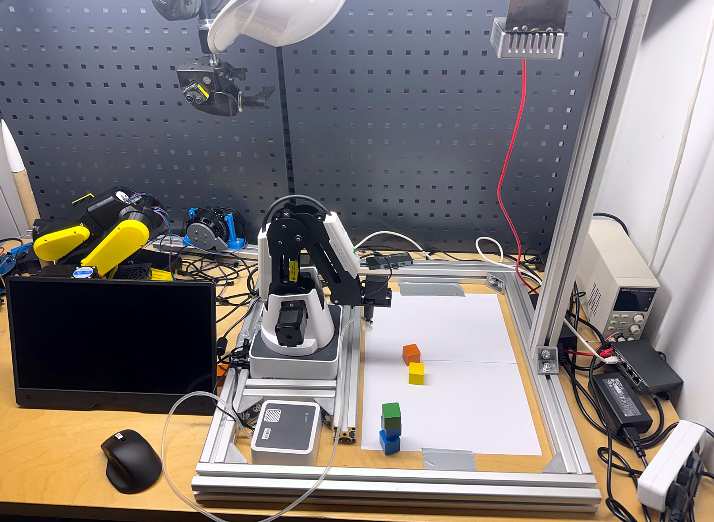
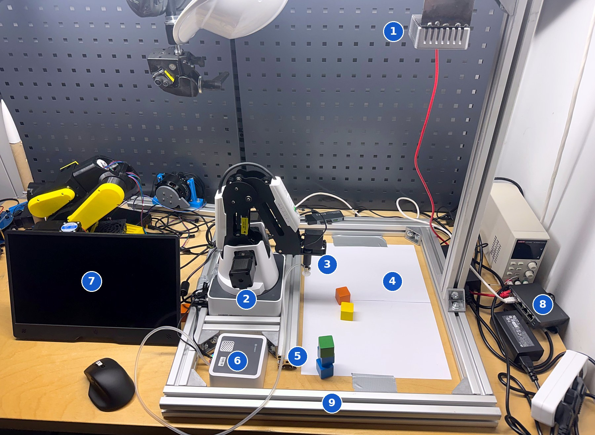
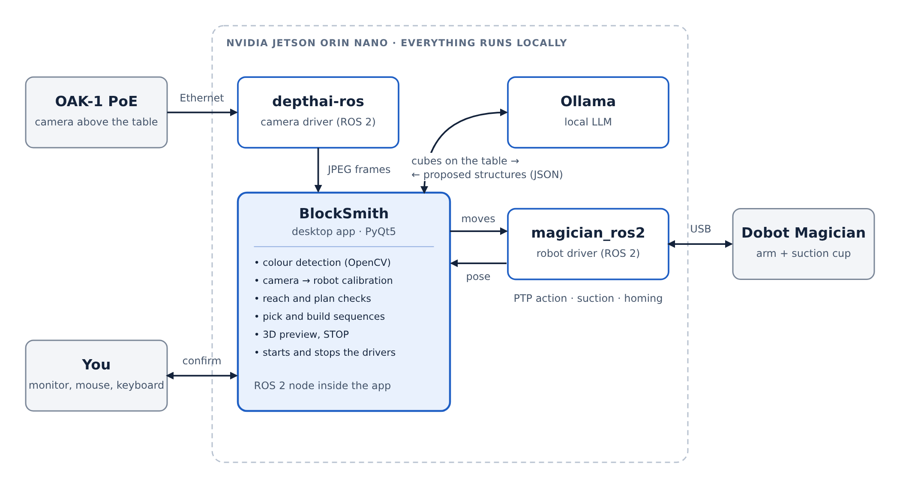
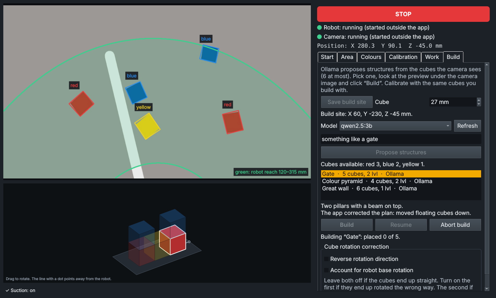

# BlockSmith

A single-window desktop app that lets a **Dobot Magician** see coloured blocks through an overhead camera, pick them by colour, and build small structures that a **local LLM (Ollama)** proposes. Everything runs on an **NVIDIA Jetson Orin Nano**: no cloud, no browser.



## What it does

- **Starts and stops the drivers.** The robot driver and the camera driver are launched from the app, with status lamps and a log.
- **Finds blocks by colour.** You mark a work area on the camera image and teach the colours by showing one block of each.
- **Calibrates camera to robot.** Five guided points map what the camera sees to robot coordinates. No checkerboard needed.
- **Shows the robot's reach.** A green ring on the camera image marks where the arm can go, so you can see why a block is skipped.
- **Picks and sorts.** "Pick one" or "Pick all" for any taught colour, with a STOP button always visible.
- **Builds structures.** Ollama gets the list of cubes on the table and proposes up to three structures. The app checks and repairs every plan (no floating cubes, no more cubes than available), shows a rotatable 3D preview, and builds only after you confirm.
- **Polish and English interface**, switchable at runtime.

## Hardware

| Part | Used here |
|---|---|
| Robot arm | Dobot Magician with suction cup and rotation servo |
| Computer | NVIDIA Jetson Orin Nano Super Developer Kit (8 GB) |
| Camera | Luxonis OAK-1 PoE, mounted above the table |
| Blocks | Painted wooden cubes, 27 mm |

The full list with cables, storage and alternatives is in [docs/BOM.md](docs/BOM.md).

## The setup



| # | Part | Role |
|---|---|---|
| 1 | OAK-1 PoE camera | Looks down at the work area from an aluminium profile arm. The red cable carries data and power. |
| 2 | Dobot Magician | The arm. Bolted to the same frame as the camera mount. |
| 3 | Suction cup with rotation servo | Picks the cubes and turns them square before placing. |
| 4 | Work area | Plain white paper: a neutral background makes colour detection reliable. |
| 5 | Painted wooden cubes, 27 mm | Here: a three-cube tower built by the robot, two more cubes waiting. |
| 6 | Air pump box | Supplies vacuum to the suction cup. |
| 7 | Monitor | The app is a desktop window on the Jetson. |
| 8 | PoE switch | Powers the camera and links it to the Jetson. |
| 9 | Aluminium profile frame | Keeps robot, camera and work area fixed to each other, so the calibration stays valid. |

The Jetson itself is not visible in this photo.

## How it fits together



- **ROS 2 Humble** carries robot motion and camera frames.
- **OpenCV** detects blocks by hue and saturation inside the work area.
- **Ollama** only proposes *what* to build. Geometry, reach checks and motion are done by the app.

## The app



*App screenshots in this repository show a simulated camera scene used for testing.*

## Quick start

On a Jetson with JetPack 6 (Ubuntu 22.04), ROS 2 Humble, the Dobot driver, the OAK driver and Ollama already installed:

```bash
git clone https://github.com/karbie6920/blocksmith.git ~/dobot_web
bash ~/dobot_web/dobot-app.sh            # Polish interface
bash ~/dobot_web/dobot-app.sh --lang en  # English interface
```

Then work through the tabs from left to right: **Start → Area → Colours → Calibration → Work → Build**.

Installing everything from a fresh Jetson is covered step by step in [docs/MANUAL.md](docs/MANUAL.md).

## Documentation

- [docs/MANUAL.md](docs/MANUAL.md): installation, first run, every tab explained, configuration reference
- [docs/BOM.md](docs/BOM.md): bill of materials
- [docs/TROUBLESHOOTING.md](docs/TROUBLESHOOTING.md): problems hit while building this, with fixes

## Safety

The STOP button cancels motion in software. **It is not an emergency stop.** Keep a hand near the robot's power switch, keep the workspace clear during homing, and start at low speed (30%) after any change to calibration or build site.

## Status and limits

This is a hobby project built on one setup. Treat it as a working example, not a product.

- Developed on a Jetson Orin Nano Super 8 GB with JetPack 6.2.1, ROS 2 Humble, a Dobot Magician and an OAK-1 PoE.
- The helper scripts in `scripts/` were assembled from steps run by hand and have not been run end to end on a fresh system.
- Blocks are detected by colour only. Black, white and grey blocks are not supported, and two touching blocks of the same colour merge into one.
- The camera has no depth. All blocks must have the same height as the block used for calibration.
- Structures use identical cubes on a grid: a cube stands on the table or exactly on another cube. At most 6 cubes.
- Reach limits (120–315 mm from the base axis) are defaults, adjustable in the Calibration tab.
- Interface source texts in the code are Polish (English comes from the table in `i18n.py`), and colour names are stored under Polish keys. Comments and documentation are English.

## Repository layout

| File | Purpose |
|---|---|
| `dobot_app.py` | Main window: drivers, work area, colours, calibration, pick and sort |
| `build_tab.py` | Build tab: Ollama proposals, plan repair, 3D preview, building |
| `colours.py` | Colour detection (also runs standalone as a camera test) |
| `i18n.py` | Interface languages (Polish source texts, English table) |
| `dobot_web.py` | ROS 2 bridge and motion queue; also an optional web console |
| `index.html` | Page for the optional web console (Polish only) |
| `dobot-app.sh` | Launcher that sources ROS and starts the app |
| `scripts/` | Install helpers for the Dobot driver and the camera network |
| `tests/` | Logic tests that run without a robot or ROS |

## Tests

```bash
python3 tests/test_logic.py
```

Covers plan repair, built-in templates, calibration maths, pick and build sequences, colour detection on a synthetic image, and the translation table. Needs only Python 3, NumPy, OpenCV and PyQt5.

## Credits

- [magician_ros2](https://github.com/jkaniuka/magician_ros2) by Jan Kaniuka: the ROS 2 control stack for the Dobot Magician
- [depthai-ros](https://github.com/luxonis/depthai-ros) by Luxonis: the OAK camera driver
- [Ollama](https://ollama.com): local LLM runtime

Dobot and Magician are trademarks of their owner. This project is not affiliated with Dobot, Luxonis or NVIDIA.

## License

MIT, see [LICENSE](LICENSE).
