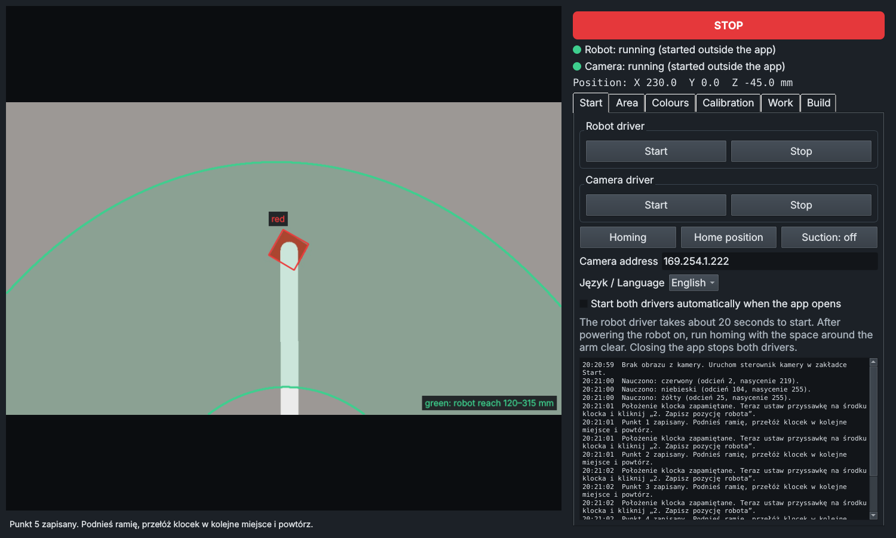
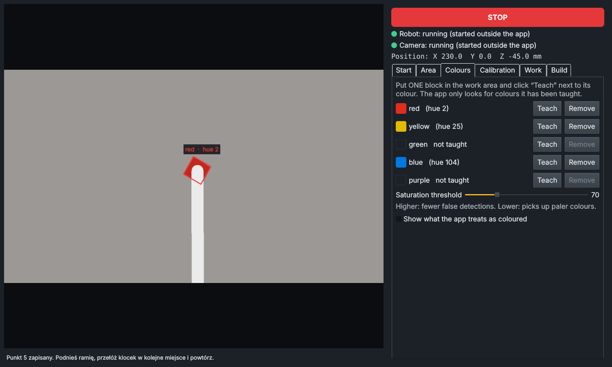
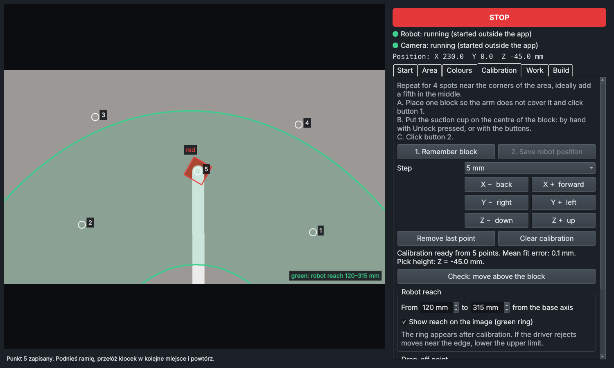
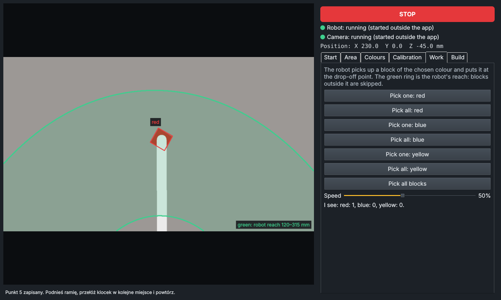
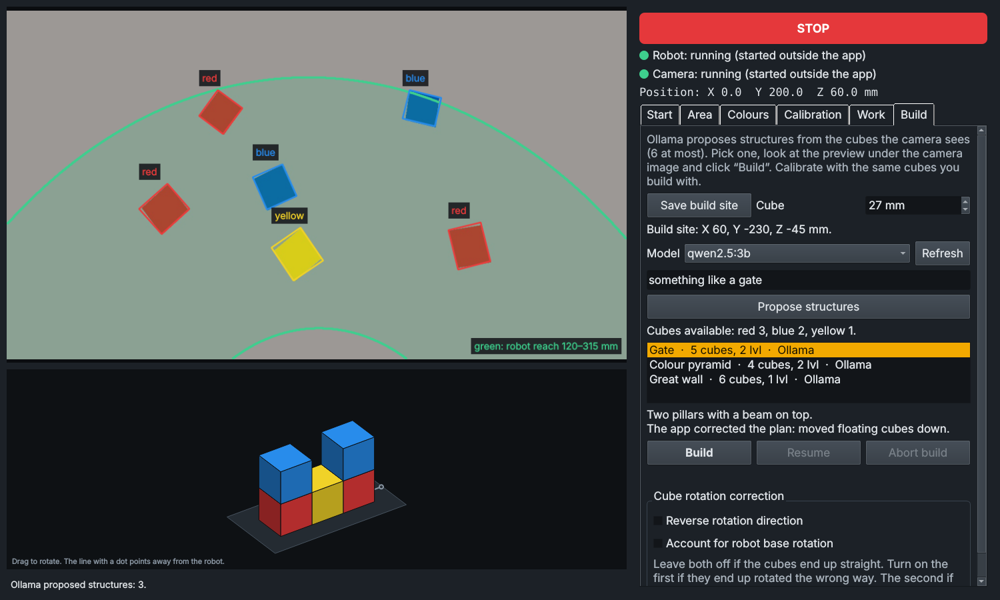

# BlockSmith manual

1. [How it works](#1-how-it-works)
2. [Hardware setup](#2-hardware-setup)
3. [Software installation](#3-software-installation)
4. [First run, tab by tab](#4-first-run-tab-by-tab)
5. [Everyday use](#5-everyday-use)
6. [Configuration reference](#6-configuration-reference)
7. [Safety](#7-safety)

Problems and fixes are collected in [TROUBLESHOOTING.md](TROUBLESHOOTING.md).

---

## 1. How it works

The app is one window. The camera image is on the left, the controls are in tabs on the right, and a red STOP button stays at the top.

- The **camera** looks down at the table. The app finds blocks by colour inside a work area you mark.
- A **calibration** maps image positions to robot coordinates on the plane of the block tops.
- The **robot** is driven through the `magician_ros2` driver: a point-to-point motion action plus suction and homing services.
- **Ollama** is asked only for ideas: given the cubes on the table, it returns structures as lists of cubes on a grid. The app repairs each plan so that it can be built, shows it in 3D, and builds it after you confirm.

All coordinates are in the robot's frame: X forward from the base, Y to the robot's left, Z up, in millimetres.

## 2. Hardware setup

1. **Robot.** Fit the suction cup with its rotation servo, connect the air tube and the servo cable, and connect the pump box. Plug the robot's USB cable into a USB-A port on the Jetson.
2. **Camera.** Mount the OAK-1 PoE above the table, looking down, so that it sees the whole area the robot can reach. Connect it through a PoE injector to the Jetson's Ethernet port. The Jetson port does not power the camera by itself.
3. **Table.** Use a neutral, matte surface. Keep coloured objects out of the camera's view, or exclude them later with the work area.
4. **Rigidity.** Fix the camera mount and the robot so they cannot shift relative to each other. Any shift means repeating the calibration.
5. **Drop-off and build site.** Leave free space within the robot's reach but outside the work area. The arm parks there after each block so that it does not hide the table from the camera.

## 3. Software installation

These steps assume a Jetson Orin Nano developer kit. Commands are run on the Jetson.

### 3.1 JetPack

Flash **JetPack 6.2.x** (Ubuntu 22.04). ROS 2 Humble installs natively on it, which is why JetPack 6 is used rather than JetPack 7.

- SD card image and instructions: NVIDIA's "Jetson Orin Nano Developer Kit Getting Started" page.
- If the kit does not boot a JetPack 6 card, its firmware is older and must be updated first (NVIDIA's "JetPack 6.x Update Path").
- Running from an NVMe SSD is strongly recommended. Either flash the SSD with NVIDIA SDK Manager, or boot from SD and copy the system with [jetsonhacks/migrate-jetson-to-ssd](https://github.com/jetsonhacks/migrate-jetson-to-ssd).

After the first boot:

```bash
sudo apt update && sudo apt full-upgrade -y
sudo apt install -y python3-pip python3-opencv python3-pyqt5 git curl nano
```

Set the power mode to **MAXN SUPER** from the NVIDIA icon in the top bar.

### 3.2 ROS 2 Humble

Follow the official [Ubuntu (deb packages) guide](https://docs.ros.org/en/humble/Installation/Ubuntu-Install-Debians.html) and install `ros-humble-desktop` and `ros-dev-tools`.

If your system locale uses a decimal comma (Polish, Hungarian, German and others), force a decimal point for numbers. Several ROS tools misread numbers otherwise:

```bash
echo 'export LC_NUMERIC=en_US.UTF-8' >> ~/.bashrc
echo 'source /opt/ros/humble/setup.bash' >> ~/.bashrc
```

### 3.3 Dobot driver

```bash
bash scripts/install_dobot_driver.sh
sudo reboot
```

The script installs [magician_ros2](https://github.com/jkaniuka/magician_ros2) into `~/dobot_ros_ws` and applies what was needed on this setup:

- the serial port is changed from `/dev/ttyUSB0` to `/dev/ttyACM0`,
- the USB ID `1a86:55d4` is added to the driver's "is the robot connected" check,
- `PyQt5` is skipped when installing Python requirements, because it does not build from pip on ARM and the system package already provides it,
- your user is added to the `dialout` group (this is why a reboot is needed).

Check after the reboot, with the robot connected and switched on:

```bash
lsusb | grep 1a86          # the robot's USB serial adapter
ls /dev/ttyACM*            # /dev/ttyACM0
```

If your robot shows a different USB ID or port, edit the two `sed` lines in the script.

### 3.4 Camera driver and network

```bash
sudo apt install -y ros-humble-depthai-ros
```

A PoE camera connected straight to the Jetson (through a PoE injector or an unmanaged PoE switch, no router) gets no address from DHCP and falls back to `169.254.1.222`. Give the Jetson's Ethernet port a link-local address so the two can talk:

```bash
bash scripts/setup_oak_poe_network.sh
ping -c 4 169.254.1.222
```

If the camera sits on a normal network with a router, skip the script and put the camera's address into the **Camera address** field in the app instead (or leave the field empty to use the first camera found).

Only one program can use the camera at a time. Close OAK Viewer before starting the app.

### 3.5 Ollama

```bash
curl -fsSL https://ollama.com/install.sh | sh
ollama pull qwen2.5:3b      # an example; any small chat model works
ollama list
```

With 8 GB of memory shared between the system, the camera pipeline and the model, stay with models of about 3–4 billion parameters.

### 3.6 The app

```bash
git clone https://github.com/karbie6920/blocksmith.git ~/dobot_web
bash ~/dobot_web/dobot-app.sh
```

`dobot-app.sh` sources ROS 2 and the Dobot workspace, then starts the app. Add `--lang en` to start in English. The language can also be changed in the Start tab and is remembered.

## 4. First run, tab by tab

Work through the tabs from left to right. Each step is saved, so it is done once.

### Start



1. Click **Start** for the robot driver. The lamp turns yellow, then green after about 20 seconds.
2. Click **Start** for the camera driver. The camera image appears on the left.
3. Clear the space around the arm and click **Homing**. Do this after every power-up of the robot.

The log at the bottom shows everything the drivers print. If a lamp turns red, the reason is there.

### Area

Click **Mark area**, then click the four corners of the region where blocks will lie. Everything outside is ignored and dimmed. Keep the area inside the green reach ring once calibration is done (see below).

### Colours



Put **one** block in the work area and click **Teach** next to its colour. Repeat for each colour you use. The app looks only for taught colours.

- **Saturation threshold:** raise it if the table is picked up as a block, lower it if pale blocks are missed.
- **Show what the app treats as coloured** helps when something is detected that should not be.
- Blue and purple are close in hue. The app warns if two taught colours are too close to tell apart.

Teach colours again if the lighting changes noticeably.

### Calibration



Calibration tells the app where on the table each image point is. Use the same kind of block you will work with, because the calibration is exact only at that block height.

For each of 4 spots near the corners of the work area, plus ideally a fifth in the middle:

1. Place one block. Keep the arm out of the camera's view of it. Click **1. Remember block**.
2. Put the suction cup on the centre of the block's top face. Either press the Unlock button on the forearm and move the arm by hand, or use the jog buttons.
3. Click **2. Save robot position**.

It takes two clicks per point because once the suction cup sits on the block, the arm hides it from the camera.

- With 5 or more points the app shows the mean fit error. Around 1 mm is good; above 5 mm, clear and repeat.
- **Check: move above the block** hovers the suction cup 15 mm over a detected block so you can judge the aim by eye.
- The height of the suction cup during calibration becomes the **pick height**.

**Robot reach.** After calibration a green ring on the image shows where the robot can reach. The defaults are 120–315 mm from the base axis. If the driver rejects moves near the outer edge, lower the upper limit.

**Drop-off point.** Place a block where picked blocks should go, outside the work area, put the suction cup on it and click **Save drop-off point**. Blocks are released from 40 mm above this point by default so that they do not collide with blocks already there.

### Work



- **Pick one: \<colour\>** takes one block of that colour to the drop-off point.
- **Pick all: \<colour\>** and **Pick all blocks** repeat until none are left. The scene is re-read after every block.
- Blocks labelled *too far* or *too close to the robot* are skipped.
- Start at 30% speed.

### Build



Building uses identical cubes (27 mm by default, adjustable).

1. **Recalibrate with the cubes** if the calibration was made with blocks of another height.
2. Place a cube where the structure should stand, outside the work area, put the suction cup on it and click **Save build site**. Remove the cube.
3. Put the cubes in the work area. Optionally type a wish, for example "something tall".
4. Click **Propose structures**. On a Jetson this can take up to a minute.
5. Select a proposal. The 3D preview appears under the camera image; drag to rotate it.
6. Click **Build** and confirm.

What the app does with Ollama's answer:

- cubes floating in mid-air are moved down,
- plans are trimmed to 6 cubes and to the cubes actually available,
- colours that are not available are replaced,
- duplicates and near-identical shapes are dropped.

Every change is listed under the description. If Ollama does not answer or fewer than three usable plans remain, built-in templates (tower, stairs, wall, castle) fill the list and are marked as such.

During the build each cube is picked, rotated so its edges line up with the robot's axes, and placed. If a needed colour runs out, the build pauses: add a cube and click **Resume**.

**Cube rotation correction.** If cubes end up rotated the wrong way, tick *Reverse rotation direction*. If the skew depends on where the cube was picked from, tick *Account for robot base rotation*. Leave both off when cubes land straight.

## 5. Everyday use

1. Switch on the robot and start `bash ~/dobot_web/dobot-app.sh`.
2. Start tab: start both drivers (or tick the autostart box once), then **Homing**.
3. Go to Work or Build.

Closing the app stops both drivers.

`colours.py` can be run on its own (`python3 colours.py`) to test colour detection with only the camera driver running.

## 6. Configuration reference

Settings are stored in `dobot_app.json` next to the app. Delete the file to start from scratch.

| Key | Meaning | Default |
|---|---|---|
| `lang` | Interface language, `pl` or `en` | `pl` |
| `roi` | Work area: four corners as fractions of the image | none |
| `colors` | Taught colours: hue (0–179) and saturation (0–255) | none |
| `s_min`, `v_min` | Minimum saturation and brightness for a pixel to count as coloured | 70, 50 |
| `calib` | Calibration points: image position, robot XY, robot Z | none |
| `reach_min`, `reach_max` | Reach limits from the base axis, mm | 120, 315 |
| `drop`, `drop_height` | Drop-off point and release height above it, mm | none, 40 |
| `build_site` | Build site (suction cup on a cube standing on the table) | none |
| `cube_size`, `cube_gap` | Cube edge and horizontal gap between cubes, mm | 27, 2 |
| `rot_invert`, `rot_base` | Cube rotation corrections | off |
| `ollama_model` | Model used for proposals | first from `ollama list` |
| `camera_ip` | Camera address; empty means the first camera found | `169.254.1.222` |
| `autostart` | Start both drivers when the app opens | off |
| `speed` | Motion speed, percent | 50 |

Environment variables:

| Variable | Meaning | Default |
|---|---|---|
| `OLLAMA_URL` | Ollama address | `http://127.0.0.1:11434` |
| `DOBOT_Z_MIN` | Lowest allowed Z, mm | `-70` |
| `DOBOT_CAM_TOPIC` | ROS topic with JPEG frames | `/oak/rgb/image_raw/compressed` |
| `MAGICIAN_TOOL` | Tool type for the Dobot driver | `suction_cup` |

Command line: `dobot-app.sh --lang en|pl`.

### Optional web console

`python3 dobot_web.py` starts a small web page on port 8080 with a 3D model of the arm, jog buttons and free-text commands translated to motion by Ollama. Its interface is in Polish only. For the 3D view, download Three.js r128 as `three.min.js` next to the script; without WebGL the page falls back to a simplified drawing.

## 7. Safety

- **STOP is a software stop.** It cancels the current motion and the running sequence. It is not an emergency stop and does not cut power.
- Keep a hand near the robot's power switch during first runs and after any change to calibration, drop-off point or build site.
- Homing swings the arm through its full range. Clear the space first.
- After STOP, check whether the robot still holds a block (Suction button in the Start tab) before resuming.
- Every target is checked against the reach limits before it is sent, and the driver checks again. Neither check knows about objects in the way.
